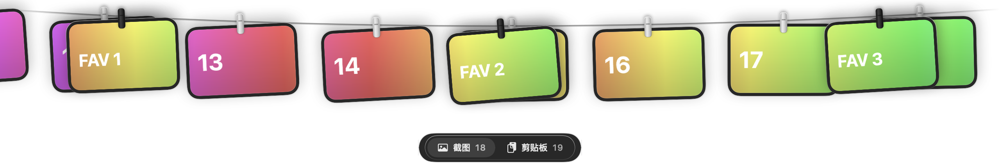

# Clipline · 晾绳

让截图，变成一道风景。

原生 macOS 菜单栏应用，把截图、录屏和剪贴板历史挂在屏幕顶部的晾绳上，配合弹性下落与轻微摇动。所有内容在本机处理。

**基于 [Alejandro Buján 的 Tendedero](https://github.com/alejandrobujan/tendedero) 改进。** 晾绳创意与基础实现来自原项目；Clipline 是独立维护的修改版，不是原作者的官方版本，也不代表原作者认可。



## 系统要求

- macOS 14 或更新版本；支持 Apple silicon 与 Intel Mac。
- 当前版本：0.1.15。没有 Windows 版本。
- 应用运行无需 Codex、Python、Homebrew 或额外运行环境。
- 当前分享构建采用 ad-hoc 签名，未经过 Apple 公证；首次打开可能需要在“系统设置 → 隐私与安全性”中选择“仍要打开”。仅在确认下载来源可信时操作。
- 已在 Apple silicon / macOS 14.7.4 环境验证；Intel、其他系统版本和多屏/其他应用全屏的实机验证尚不完整。

## Clipline 功能

| 功能 | 使用方式 |
| --- | --- |
| 文字与图片剪贴板历史 | 最多最近 100 条，支持去重、暂停、单条删除和清空；退出后清空历史 |
| 截图与剪贴板切换 | 横向滚动浏览，切换动画；底部切换栏可以隐藏 |
| 固定喜欢的照片 | 在指定位置选择图片，沿绳拖动；黑色夹子、前景遮挡与轻微摇动，跨启动保留 |
| 录屏卡片 | MOV / MP4 / M4V 文件生成后挂上绳子；悬停静音预览，移开停止 |
| 内置图片编辑器 | 画笔、荧光笔、箭头、框线、椭圆、文字、马赛克、遮盖、橡皮擦、裁切、旋转和翻转 |
| 可调整的裁切框 | 自由裁切、常用比例和固定像素尺寸；先调整选区，再确认应用 |
| 保存目录跟随 | 跟随系统截图/录屏保存位置变化，固定照片保持独立 |
| 双击展开 | 双击菜单栏空白处展开或收起，避免碰到屏幕顶部就误触 |
| 多语言与新图标 | 简体中文、繁體中文、English、Español，以及跟随系统 |

## 下载

[下载 Clipline 0.1.15 · macOS 通用安装包](downloads/Clipline-0.1.15-macOS-universal.zip?raw=true) · [SHA-256 校验值](downloads/SHA256SUMS.txt)

此包包含应用；操作说明见下方链接。

## 安装与首次设置

请使用上方应用安装包，GitHub 的 Code → Download ZIP 下载的是源码，不能直接当应用打开。

1. 解压应用安装包，把应用放到你选择的安装位置（建议“应用程序”），再打开。
2. 从菜单栏的晾绳图标进入“设置…”。开启“接管系统截图”会关闭系统浮动缩略图，让截图更快挂上绳子。
3. 若要使用菜单栏空白处双击，在“隐私与安全性 → 辅助功能”中允许**当前运行的 Clipline**。设置页可在访达中显示当前应用，每个人的安装路径可能不同。
4. 若旧版显示已授权而新版仍未生效，移除旧授权记录，再添加当前应用；以 Clipline 设置里的实际权限状态为准。关闭设置窗口后测试双击。
5. 用 `Command + Shift + 5 → 选项 → 存储到` 选择自己的截图/录屏保存目录。应用会跟随目录，不要求使用开发者电脑上的路径。

“恢复默认位置并开启即时截图”按钮会主动把保存位置改为当前用户的 `~/Pictures/Clipline Screenshots`。普通启动不会强行覆盖保存目录。

## 日常操作

- `Command + Shift + 3 / 4`：使用系统截图快捷键。
- 双击菜单栏空白处，或按 `Control + Option + T`：展开或收起晾绳。
- `Control + Option + V`：展开或收起剪贴板历史。
- 触控板左右滑动，或按住 Shift 滚动鼠标滚轮：横向浏览。
- 单击卡片：重新复制；到目标应用按 `Command + V` 粘贴。
- 长按图片：打开内置编辑器；双击或右键打开菜单，“打开”可交给系统“预览”。
- 图片菜单里的“在此位置固定图片”：选择自己的照片，再拖动固定位置。
- 截图/录屏卡片的叉号：将原文件移到系统废纸篓。“取下”和“全部取下”只移除卡片，保留原文件。
- 编辑保存生成 PNG 副本，保留原图。预设裁切只生成选框，点击“应用裁切”才真正裁切。
- 全屏应用下，先让系统菜单栏显示再双击；也可使用快捷键。

[完整使用说明 PDF](docs/guide-zh-CN.pdf) · [使用说明长图](docs/guide-zh-CN.png)

## 本地内容与限制

剪贴板历史只存于当前进程内存，退出即清空；暂停期间的复制不会补录。最多 100 条，同时有内存预算限制，大图片较多时可能不足 100 条。不提供跨设备同步或自动粘贴。

固定照片会复制到当前用户的应用资料目录，因此移动原图或切换截图目录不会使固定照片失效。取消固定只删除应用副本。

目录只读取本层，不扫描子目录。混合目录中的图片和视频可能一起挂上晾绳，建议选择专用目录；桌面图片按系统截图标记筛选。切换目录或历史超限不会删除原文件。

程序不联网、不上传截图或剪贴板内容。单条文字限制 1 MiB，单张图片编码限制 16 MiB、解码像素限制 4000 万，历史总编码预算 64 MiB。录屏同时最多预览一个。

## 从源码构建

需要 macOS、Command Line Tools 中的 Swift，以及构建脚本使用的 Python 3。无需第三方 Swift 包。

```sh
bash scripts/build-app.sh
open build/Clipline-0.1.15.app
```

同时构建 Apple silicon / Intel 架构：

```sh
CLIPLINE_ARCHS="arm64 x86_64" bash scripts/build-app.sh
```

构建仅生成本地 ad-hoc 签名应用，不会自动安装、获得辅助功能权限或完成 Apple 公证。

独立检查入口位于 `scripts/test-*.sh`，对应源码在 `Tests/`。测试尽量使用虚构图片、临时文件、独立命名剪贴板和应用自身离屏窗口；多屏与其他应用全屏交互仍需要实机验收。

```sh
bash scripts/test-clipboard.sh
bash scripts/test-editor-window.sh
bash scripts/test-settings.sh
bash scripts/test-localization.sh
```

## 来源与许可

上游项目：[Tendedero](https://github.com/alejandrobujan/tendedero)，作者 Alejandro Buján。

截至本次发布，上游已更新至 1.3.0，加入图片剪贴板、录屏、横向浏览等功能；下表描述 Clipline 当前功能，并非宣称这些功能只存在于本修改版。[上游更新对照](docs/upstream-updates.md)。

本修改版基于上游提交 `3c866d94d25ee9d1e008aecd9a78a4e9b2bf06a4`，保留原作者版权声明和 [LICENSE](LICENSE)。上游源码采用 MIT 许可，允许修改和再发布。上游名称、图标及原 docs 图像不包含在源码许可内；本项目使用 Clipline 名称与独立绘制的新图标、展示图片。


